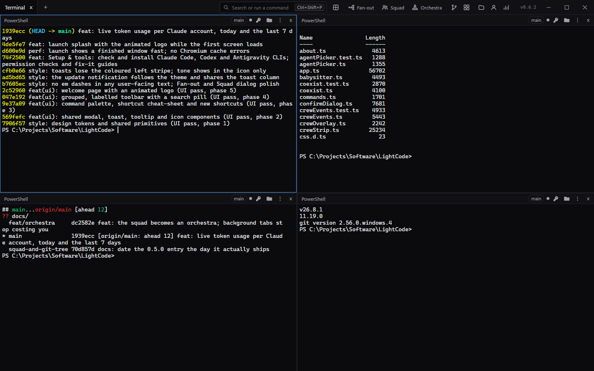
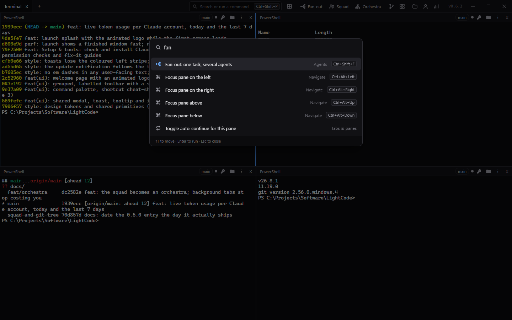
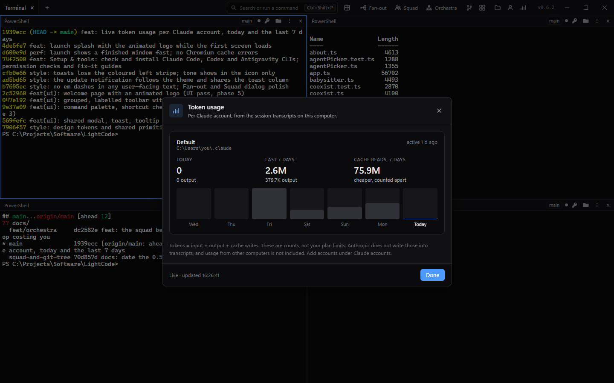
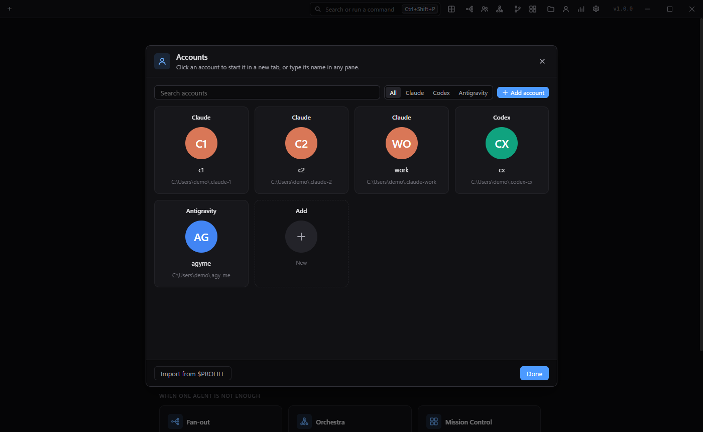
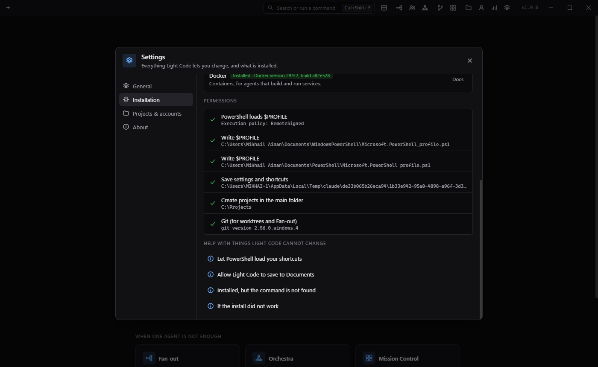

<div align="center">


# Light Code

**The calm cockpit for running many AI coding agents at once.**

Run Claude Code, Codex and plain shells side by side in tabs and split panes,
see which one needs you, and give each its own git worktree. Free and open source.

[](https://github.com/digitalscapemy/lightcode/releases/latest)
[](https://github.com/digitalscapemy/lightcode/releases)
[](LICENSE)

[](CONTRIBUTING.md)

[Download](#install) · [Features](#features) · [Shortcuts](#keyboard-shortcuts) · [Contributing](#contributing) · [Discussions](https://github.com/digitalscapemy/lightcode/discussions)



</div>

## Why Light Code

One agent in one terminal is easy. Six agents across four projects and two accounts is not:
you lose track of which pane is which, which one is waiting on a permission prompt, and which
two are quietly editing the same files.

Light Code is a terminal built for that. Every pane knows its project, its branch, its agent
and its status, and the app stays fast with sixty terminals open. It never takes over: every
pane is a real shell, and everything Light Code adds is optional.

## Features

### A workspace that scales

- **Tabs and split panes**, with layout presets from 1 to 16 panes and full tab names that never
  get cut off. Tabs that do not fit are one click away in the overflow list.
- **Command palette** (`Ctrl+Shift+P`, `⌘K` on macOS): find any command, tab or saved project by
  typing a few letters.
- **Fast with many panes**: background tabs do not repaint, and a saved workspace of 60 terminals
  opens with the visible tab first and the rest following in the background.



### Built for agents

- **Live status on every pane and tab**: working, waiting for you, or waiting for a permission
  prompt. `Ctrl+Shift+J` jumps to the pane that needs you.
- **Fan-out**: give one task to several agents at once, each on its own branch in its own
  worktree, and keep the best answer.
- **Orchestra**: one lead pane directs worker panes, and you see every worker's state, last line
  and reports from one place. Start one from preset roles (developer, UI/UX, devops, security).
- **`lc`, the agent CLI**: lets an agent drive other panes (send, ask, wait, spawn), with
  guards against answering a permission prompt by accident.
- **Runs Claude Code and Codex in any pane**, plus plain shells; Gemini support is experimental.

### Know what is happening

- **Token usage per pane**, and per Claude account for today and the last 7 days.
- **Mission Control**: every session in the window at a glance; send one message to many.
- **Worktrees panel**: every branch and worktree, how far it is from main, and which pane is in it.
- **Shared-folder warning** when two agents run unattended in the same working tree.



### Projects and accounts, one click away

- **Projects** show as cards, grouped by category. Click one to open it in a new tab, or type its
  name in any pane to jump there. Search, add and edit right in the grid.
- **Accounts for Claude, Codex and Antigravity**, each in its own folder. Click an account to
  start it in a new tab, or type its name in any pane. Claude and Codex keep each login fully
  apart. Antigravity keeps settings and conversations apart, but its Google login is shared,
  because Antigravity stores it in the system credential store.
- Both are written to your shell profile, so they work in any terminal, not only Light Code.



### Settings and setup that help instead of failing

- **Settings** (the gear in the toolbar) gathers everything in one place: terminal text size, git
  auto-fetch, the `lc` agent CLI, projects and accounts, updates, and what is installed.
- **Installation** checks Claude Code, Codex, the Antigravity CLI, Docker and, on Windows, WSL,
  and shows their versions. All of them are optional. A missing one installs with one click, using
  the vendor's official command in a new tab you can watch.
- **Permission checks** for everything Light Code needs, such as writing your shortcuts to
  `$PROFILE`, with step-by-step guides for the fixes only you can make (execution policy,
  Controlled folder access, PATH after an install).



### And the details

Ctrl+click links to open them in your browser, paste screenshots straight into Claude, drag files
in to type their paths, and automatic updates.

## Install

Each link always serves the newest release.

| Your machine | Download |
| --- | --- |
| Windows 10 or 11 | [LightCode-Setup.exe](https://github.com/digitalscapemy/lightcode/releases/latest/download/LightCode-Setup.exe) |
| Mac with Apple Silicon (M1 or newer) | [LightCode-arm64.dmg](https://github.com/digitalscapemy/lightcode/releases/latest/download/LightCode-arm64.dmg) |
| Mac with Intel | [LightCode-x64.dmg](https://github.com/digitalscapemy/lightcode/releases/latest/download/LightCode-x64.dmg) |

Not sure which Mac you have? Apple menu, **About This Mac**: "Chip: Apple M..." means Apple
Silicon, "Processor: Intel" means Intel. macOS 12 Monterey or newer is required.

Light Code is not code-signed yet, so both systems warn you the first time:

- **Windows**: on the blue "Windows protected your PC" screen, click **More info**, then
  **Run anyway**.
- **macOS**: drag Light Code to Applications, then **right-click** it and choose **Open**. If macOS
  still refuses, use **System Settings, Privacy & Security, Open Anyway**, or run once in Terminal:

  ```sh
  xattr -cr "/Applications/Light Code.app"
  ```

After that Light Code updates itself. On Windows updates install in place; on macOS you are
notified and the right `.dmg` opens for you.

Light Code works as a plain terminal on its own. Agent features need an agent CLI:
open **Settings, Installation** (the gear in the toolbar) to check and install them, along with
WSL and Docker if you want them. Every one is optional.

## Keyboard shortcuts

`Mod` is `Ctrl` on Windows and `⌘` on macOS. Press `Mod+Shift+/` in the app for the full list.

| Action | Shortcut |
| --- | --- |
| Command palette | `Mod+Shift+P` (also `⌘K` on macOS) |
| New tab | `Mod+Shift+T` |
| Split right / split down | `Mod+Shift+E` / `Mod+Shift+D` |
| Maximize or restore pane | `Mod+Shift+Enter` |
| Close pane | `Mod+Shift+W` |
| Next / previous pane | `Ctrl+Tab` / `Ctrl+Shift+Tab` |
| Move focus between panes | `Mod+Alt+Arrow` |
| Jump to the pane that needs you | `Mod+Shift+J` |
| Choose a layout | `Mod+Shift+L` |
| Fan-out | `Mod+Shift+F` |
| Orchestra panel | `Mod+Shift+O` |
| Approve the waiting worker | `Mod+Shift+Y` |
| Worktrees panel | `Mod+Shift+G` |
| Mission Control | `Mod+Shift+M` |
| Text size | `Mod+=` / `Mod+-` / `Mod+0` |

Every shortcut uses `Mod+Shift` or `Mod+Alt`, so the keys your shell and agent need (such as
`Ctrl+C`, `Ctrl+K` and `Ctrl+R`) always reach the terminal.

## Build from source

You need Node.js 22.12 or newer and Git.

```sh
git clone https://github.com/digitalscapemy/lightcode.git
cd lightcode
npm install
npm run dev
```

| Command | What it does |
| --- | --- |
| `npm run dev` | Run the app with hot reload |
| `npm run typecheck` | TypeScript check |
| `npm test` | Unit tests (Vitest) |
| `npm run dist` | Build an installer for the platform you are on |

Built with [Electron](https://electronjs.org), [electron-vite](https://electron-vite.org),
[xterm.js](https://xtermjs.org) and [node-pty](https://github.com/microsoft/node-pty).
See [CONTRIBUTING.md](CONTRIBUTING.md) for the project layout, the house rules and the release
process.

## Contributing

Light Code is open source and contributions are very welcome, from a typo fix to a new feature.

- **Found a bug?** [Open an issue](https://github.com/digitalscapemy/lightcode/issues/new/choose)
  with what you did, what you expected and what happened.
- **Have an idea or a question?** Start a thread in
  [Discussions](https://github.com/digitalscapemy/lightcode/discussions).
- **Want to code?** Read [CONTRIBUTING.md](CONTRIBUTING.md), then look for issues labelled
  [`good first issue`](https://github.com/digitalscapemy/lightcode/labels/good%20first%20issue)
  or [`help wanted`](https://github.com/digitalscapemy/lightcode/labels/help%20wanted).
- **Using Light Code in your work?** Tell us in Discussions; it helps decide what to build next.

Please follow our [Code of Conduct](CODE_OF_CONDUCT.md). To report a security problem, see
[SECURITY.md](SECURITY.md) instead of opening a public issue.

If Light Code saves you time, a star on GitHub helps other people find it.

## License

[MIT](LICENSE) © 2026 Digital Scape MY
